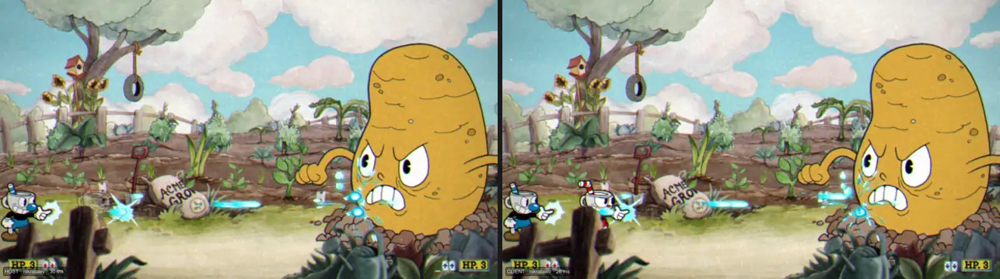
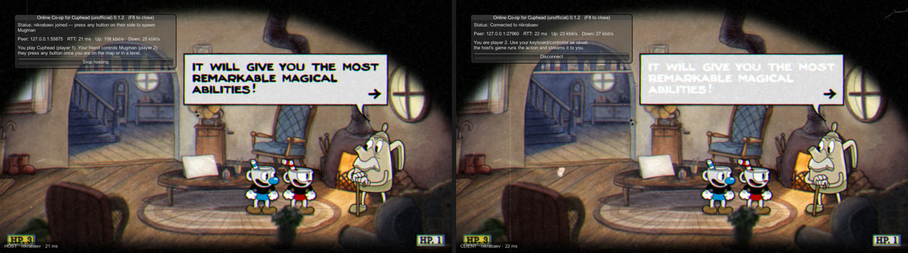
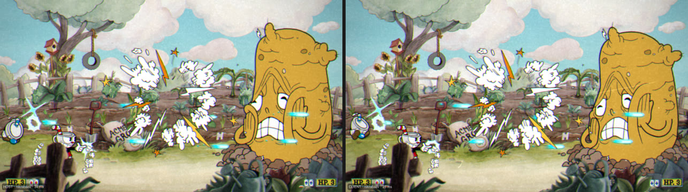

<div align="center">

# ☕ Online Co-op for Cuphead

**Play Cuphead with a friend over the internet.**<br>
You play Cuphead on your own save. Your friend joins as Mugman from their own computer, anywhere.

[](https://github.com/nikrabaev/cuphead-online-coop/releases/latest)
[](#macos)
[](#windows-experimental)
[](LICENSE)



<sub><b>Left:</b> the host's game. <b>Right:</b> the guest's game, mirrored live over the network. Same frame, two computers.</sub>

<br>

**[Install](#-install)** · **[How to play](#-how-to-play)** · **[Uninstall](#%EF%B8%8F-uninstall)** · **[FAQ](#-faq)** · **[How it works](#-how-it-works)**

</div>

> [!NOTE]
> An unofficial fan project, not affiliated with or endorsed by StudioMDHR. Both players need their own copy of
> Cuphead (Steam, version 1.3.4) and this mod. See [Legal](#%EF%B8%8F-legal).

## ✨ Features

- **Real co-op, drawn natively.** The guest's game renders every sprite itself at full resolution. You watch the
  game, not a compressed video stream.
- **Steam invites, no port forwarding.** Host through Steam and invite a friend from the overlay, or connect
  directly by IP.
- **The whole game.** World map, boss fights, run 'n gun levels, menus, cutscenes, the HUD, music and sound
  effects. Mugman joins exactly like a second local controller.
- **Your save, your progress.** Everything is saved to the host's slot, as in local co-op. The guest's save files
  are never touched.
- **One-line install and uninstall.** Downloads are verified against SHA-256 checksums. No developer tools needed.

## 🚀 Install

The installer downloads two things and nothing else: [BepInEx](https://github.com/BepInEx/BepInEx) 5.4.23.5 (the
standard Unity mod loader) from its official release, and this mod from the
[latest release](https://github.com/nikrabaev/cuphead-online-coop/releases/latest). Both are checked before anything
in the game folder changes.

### macOS

Open **Terminal** and paste:

```bash
curl -fsSL https://github.com/nikrabaev/cuphead-online-coop/releases/latest/download/install-macos.sh | bash
```

It finds Cuphead in your Steam libraries, installs the mod, and sets Cuphead's Steam launch options so Steam starts
the game with the mod. Steam has to be closed for that step: the installer asks first and reopens Steam afterwards.

<details>
<summary>Installer options</summary>

<br>

Options go after `bash -s --`, for example `... | bash -s -- --yes`:

| Option | Effect |
|---|---|
| `--yes` | close Steam without asking |
| `--skip-launch-options` | don't touch Steam settings; print the launch options to paste yourself |
| `--game-dir "/path/to/Cuphead"` | use this Cuphead folder (the one containing `Cuphead.app`) |

Run the same command again to update to a newer release.
</details>

### Windows (experimental)

Open **PowerShell** and paste:

```powershell
irm https://github.com/nikrabaev/cuphead-online-coop/releases/latest/download/install-windows.ps1 | iex
```

Then start Cuphead from Steam as usual. On Windows the mod loads automatically; no launch options are needed. If
Cuphead isn't found, first run `$env:CUPHEAD_DIR = 'D:\SteamLibrary\steamapps\common\Cuphead'` with your own folder.

> [!WARNING]
> The mod is developed and tested on macOS. The Windows game runs the same code and the installer has been
> tested on a simulated setup, but nobody has played the mod on Windows yet. Please [open an issue](https://github.com/nikrabaev/cuphead-online-coop/issues)
> if it doesn't load.

<details>
<summary>Manual install</summary>

<br>

1. Install [BepInEx 5.4.23.5](https://github.com/BepInEx/BepInEx/releases/tag/v5.4.23.5) into the Cuphead folder
   (`BepInEx_macos_universal_*.zip` on macOS, `BepInEx_win_x64_*.zip` on Windows).
2. Download `CupheadOnline.dll` from the [latest release](https://github.com/nikrabaev/cuphead-online-coop/releases/latest)
   and put it in `BepInEx/plugins/`.
3. macOS only: in `run_bepinex.sh` set `executable_name="Cuphead.app"`, then set Cuphead's Steam launch options to
   `"/path/to/Cuphead/run_bepinex.sh" %command%`.
</details>

## 🎮 How to play

1. **Both players** start Cuphead from Steam and press **F8** to open the online menu.
2. **The host** chooses **Host via Steam** and then **Invite a Steam friend…** (or **Host by IP**).
3. **The guest** accepts the Steam invite, or picks the host from the friends list in the F8 menu
   (or enters `host-ip:27960`). The guest's screen now follows the host's game.
4. **The host** goes to the world map or a level. The guest presses any button and Mugman jumps in.

<p align="center">
  
  <br>
  <sub>The F8 menu on the host (left) and the guest (right), connected with a 21 ms round trip.</sub>
</p>

| | Host (player 1, Cuphead) | Guest (player 2, Mugman) |
|---|---|---|
| **Steam** (no port forwarding) | **Host via Steam**, then **Invite a Steam friend…** | Accept the invite, press **Join** next to the friend, or paste the host's SteamID |
| **Direct IP** | **Host by IP** (UDP port 27960; forward it, or use Tailscale, ZeroTier or a LAN) | Enter `host-ip:27960` and **Join** |

The guest uses their own keyboard or controller as usual. Both players need the same game and mod version; the
mod checks this when joining.

## 🗑️ Uninstall

**macOS** (Terminal):

```bash
curl -fsSL https://github.com/nikrabaev/cuphead-online-coop/releases/latest/download/uninstall-macos.sh | bash
```

**Windows** (PowerShell):

```powershell
irm https://github.com/nikrabaev/cuphead-online-coop/releases/latest/download/uninstall-windows.ps1 | iex
```

This removes the mod and its settings, and BepInEx too unless you have other BepInEx mods installed. To keep BepInEx,
use `... | bash -s -- --keep-bepinex` on macOS, or run `$env:CUPHEAD_ONLINE_KEEP_BEPINEX = '1'` first on Windows. On
macOS, Cuphead's launch options are cleared as well (the uninstaller asks before closing Steam). Saves are kept.

<details>
<summary>Uninstall by hand</summary>

<br>

Delete `BepInEx/plugins/CupheadOnline.dll` from the Cuphead folder, and on macOS clear Cuphead's launch options in
Steam. Steam's *Verify integrity of game files* does not remove mod files, so delete them yourself.
</details>

## ❓ FAQ

<details>
<summary><b>Do both players need to own Cuphead?</b></summary>

<br>

Yes. Each player needs their own copy of Cuphead on Steam, version 1.3.4, with this mod installed. The mod runs
inside your installed game and does not bypass Steam's ownership check.
</details>

<details>
<summary><b>How is this different from Steam Remote Play Together?</b></summary>

<br>

Remote Play Together (Shift+Tab → invite) works with Cuphead without any mod, by streaming the host's screen as
video. With this mod the guest's own game draws the action at full resolution with no compression artifacts, and
it uses far less bandwidth. If Remote Play works well for you, it's the zero-install option.
</details>

<details>
<summary><b>What about lag?</b></summary>

<br>

The host plays with no added delay. The guest sees the game about half a round trip late, and their button presses
take about half a round trip to arrive. At typical internet pings that's hard to notice; above about 120 ms it
starts to feel like Remote Play. The F8 menu shows the current round trip.
</details>

<details>
<summary><b>Where is progress saved?</b></summary>

<br>

To the host's save slot, exactly like local co-op. While connected, the mod never writes to the guest's save files.
</details>

<details>
<summary><b>Is the install safe?</b></summary>

<br>

The installers are short scripts you can read in [`scripts/`](scripts). They only download BepInEx from its
official GitHub release and the mod from this repository's releases, and verify both against SHA-256 checksums
(the BepInEx hashes are pinned in the scripts). They change nothing outside the Cuphead folder, except Cuphead's
launch options in Steam on macOS, and they back up that Steam settings file first.
</details>

<details>
<summary><b>Does it work with the GOG or Microsoft Store versions?</b></summary>

<br>

Not officially. The installers look for the Steam version. On builds without Steam the mod is designed to fall back
to direct-IP play only, but this hasn't been tested.
</details>

<details>
<summary><b>Cuphead updated and the mod stopped working.</b></summary>

<br>

The mod is built for Cuphead 1.3.4. A game update can change the code the mod hooks into. Check the
[releases](https://github.com/nikrabaev/cuphead-online-coop/releases) for a newer version, or
[open an issue](https://github.com/nikrabaev/cuphead-online-coop/issues).
</details>

## 🔧 How it works

<p align="center">
  
  <br>
  <sub>The host's frame (left) and the guest's mirrored frame (right) at the same moment.</sub>
</p>

Cuphead's bosses use unseeded randomness everywhere, so two games simulating side by side would drift apart within
seconds. Instead the **host runs the real game** and the **guest's game becomes a live mirror**:

- **Input goes to the host.** The guest's controller is sent 60 times a second and fed into the host's game as
  player 2, so Mugman joins and plays through the game's own code.
- **The picture comes back.** The guest loads the same level, pauses its own copy of the game, and every frame
  draws the sprites, cameras, HUD and menus the host sends.
- **Sound is replayed.** Each sound effect and music cue the host plays is triggered on the guest too.

<details>
<summary><b>Technical deep dive</b></summary>

<br>

- **Input → host.** Every Cuphead input goes through Rewired's `Player.GetButton*/GetAxis(actionId)` (Cuphead's
  `PlayerInput.actions`, `PlayerManager`'s join logic, `AnyPlayerInput` for menus). The guest samples its own
  controller, sends it 60×/s with per-button press counters (so short taps survive packet loss), and the host feeds
  it into Rewired player 1 with Harmony patches. Like Rewired, button down/up edges are tracked separately for
  `Update` and `FixedUpdate`, since Cuphead polls weapon switch, jump, dash, parry and EX in `FixedUpdate`. The
  disconnect prompt is suppressed for the virtual controller.
- **World → guest.** The guest loads the same scene through Cuphead's `SceneLoader` (which also loads the
  sprite-atlas and music asset bundles), then freezes every gameplay `MonoBehaviour` at `sceneLoaded`, before
  `Level.Start` can spawn players or bosses. Every frame the host sends the visible `SpriteRenderer`s (sprite,
  transform, colour, flip, sorting, material, mask interaction), the `SpriteMask`s that clip them, the scene
  cameras, and UGUI graphics (`Image`, `Text`, TextMeshPro) as delta-compressed snapshots. Sprites are matched by
  name and geometry plus their late-bound `SpriteAtlas` tag, which the guest asks the game's own `AssetLoader` for.
- **Masks and shader parameters.** UGUI `Mask`/`RectMask2D` clipping is sent as a clip rect per graphic.
  Material parameters changed at runtime (for example Chess Bishop's `_BlurAmount` fade or the Chalice
  `_RecolorFactor`) are sent per material; the guest draws with a clone carrying the host's values.
- **Sound.** All SFX and music go through static, string-keyed `AudioManager` methods; the host records those calls
  and the guest replays them against its own `AudioManagerComponent`s. Pause is replicated the same way.
- **Transport.** Unreliable datagrams over UDP or Steam P2P (`ISteamNetworking` with Valve's relay), with a small
  ordered-reliable layer (cumulative and selective acks, backoff) for scene changes, asset names, despawns and audio.
- **A game fix on the side.** Cuphead's `SteamManager` is not `DontDestroyOnLoad`, so the first scene change shuts
  the Steam API down ("Tried to Initialize the SteamAPI twice"), breaking Steam features and DLC checks. The mod
  keeps it alive.
</details>

<details>
<summary><b>Known limitations</b></summary>

<br>

- The guest sees the game about half a round trip late (see [What about lag?](#-faq)).
- The guest sees what SpriteRenderers, SpriteMasks and UGUI draw. Not mirrored: `RawImage`s (runtime textures),
  camera image-effect parameters, and the few sounds played directly on an `AudioSource` instead of through
  `AudioManager`. UGUI stencil masks are approximated by their rectangle, which matches the game's HUD slots.
- On the title screen and the opening storybook only player 1 can press buttons (that's the game's rule).
- Two players only, as in the original game. One guest per host.
</details>

## 🛠️ For developers

<details>
<summary><b>Building, releases and testing</b></summary>

<br>

Building needs the .NET SDK and your own installed copy of Cuphead: the project references the game's assemblies
from `../Cuphead.app` (override with `-p:GameManaged=<folder>`), and BepInEx/HarmonyX come from NuGet. Nothing from
the game is copied into this repository.

- `scripts/dev-install.sh` builds and installs into your local Cuphead (clone this repository inside the Cuphead
  folder).
- `scripts/release.sh` packages a release in `dist/` (DLL, plugin zip, installers, `SHA256SUMS.txt`);
  `scripts/release.sh --publish` also creates the GitHub release for the version in `src/Plugin.cs`. Releases are
  built locally because the build needs the game's own assemblies, which can't be put on a CI server.

**Testing.** `CUPHEAD_ONLINE_SCRIPT=file` runs a scripted end-to-end test inside the game: on the host it plays
player 1, on the guest its presses travel the real network path as player 2. See `src/Sync/TestDriver.cs` for the
commands (`anykey`, `tap`, `hold`, `move`, `waitscene`, `waitp2`, `level`, `invincible`, `align`, `burst`, `shot`,
`state`, `fxdump`, …). `CUPHEAD_ONLINE_SHOTS=dir` saves screenshots and `CUPHEAD_ONLINE_DEBUG=1` writes scene and
renderer dumps to `BepInEx/LogOutput.log`. Two instances can run on one Mac (host plus `join:127.0.0.1:27960`).
Starting the game outside Steam's launcher like this needs a `steam_appid.txt` containing `268910` in the Cuphead
folder, for local testing only (Steam must still be running and own the game); don't ship that file to players.
The screenshots in this README were made this way.

**Autostart and config.** `CUPHEAD_ONLINE=host`, `host:PORT`, `steamhost`, `join:HOST:PORT` or
`steamjoin:STEAMID64` as an environment variable (or `--online=...` as a game argument) connects on startup.
Settings live in `BepInEx/config/dev.cupheadonline.mod.cfg` (player name, port, menu key, and `SendInterval = 2` to
halve the host's upload on slow connections).

```
src/Plugin.cs             BepInEx entry, config, frame loop, autostart
src/Net/                  Transport (UDP, Steam P2P), Connection (reliability), Session, SteamLobby, Protocol
src/Net/SteamSupport.cs   guarded entry point for Steam features (game builds without Steam still load)
src/Sync/RemoteInput.cs   PadState / VirtualPad, Rewired patches
src/Sync/HostSync.cs      host capture: sprites, sprite masks, cameras, UGUI (+ mask clipping)
src/Sync/ClientMirror.cs  guest: scene load + freeze, mirrored renderers, cameras, UI
src/Sync/MaterialSync.cs  runtime material parameters (host capture, guest clones)
src/Sync/AudioSync.cs     AudioManager / PauseManager call replication
src/Sync/Assets.cs        cross-process asset identity (sprites, materials, fonts, atlases)
src/Sync/SteamFix.cs      SteamManager persistence fix
src/Sync/TestDriver.cs    scripted end-to-end tests
src/UI/Overlay.cs         F8 menu
scripts/                  player installers/uninstallers, release.sh, dev-install.sh
```
</details>

## ⚖️ Legal

- **Your own copy required.** The mod only runs inside an installed, legitimately owned copy of Cuphead and does not
  bypass its Steam ownership check.
- **No game files.** No Cuphead files, decompiled code, audio or other assets are in this repository or its
  releases. The build references the developer's own installed game, like any mod. The screenshots in
  [`docs/images`](docs/images) show gameplay recorded with the mod, to illustrate what it does.
- **Licensing.** The mod's source code is MIT-licensed ([LICENSE](LICENSE)); that license grants no rights to
  Cuphead. Third-party components and their licenses are listed in [THIRD_PARTY_NOTICES.md](THIRD_PARTY_NOTICES.md).
- **Trademarks.** Cuphead is © StudioMDHR Entertainment Inc. "Cuphead" is used only to say which game this mod is
  for. Please don't use the game's logo or promotional art for this project.
- **Free and non-commercial.** Don't sell this mod or put it behind a paywall.
- If StudioMDHR asks for this project to be changed or taken down, we will comply.
